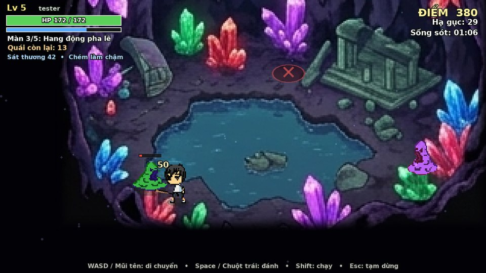
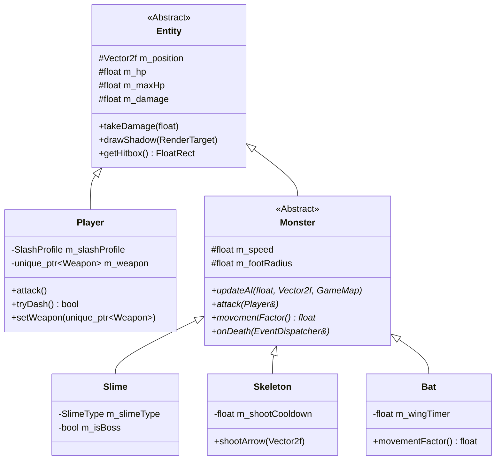
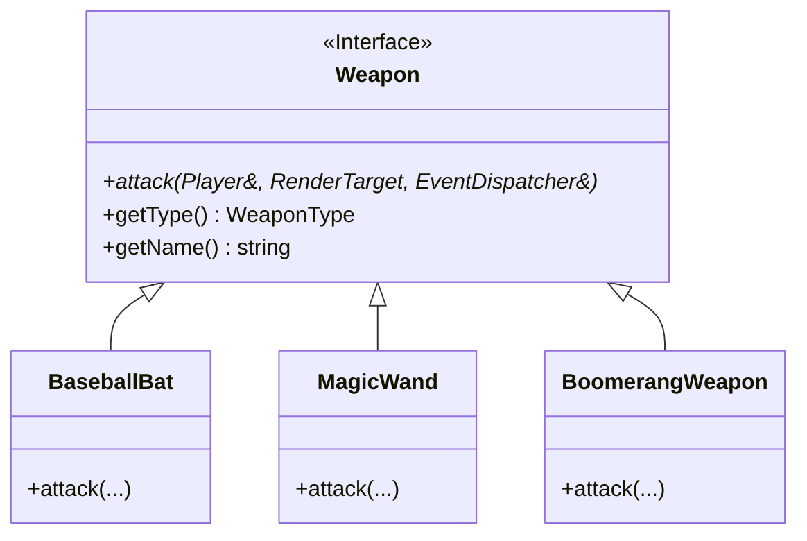
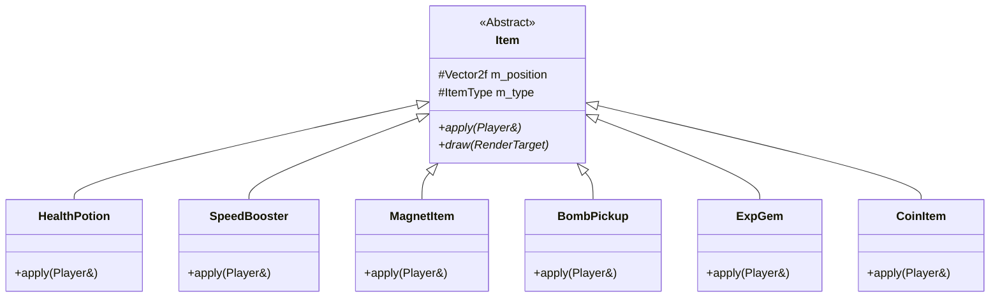

# SLIME HUNTER — 2D Action Monster Survival (C++17 / SFML 3.1)

> **Đồ án môn học: Lập trình Hướng đối tượng (Object-Oriented Programming - OOP)**  
> Ngôn ngữ: **C++17** | Thư viện đồ họa: **SFML 3.1.0** | Hệ thống build: **CMake** | Nền tảng: **Windows (MinGW UCRT64) & Linux**

Game hành động 2D góc nhìn từ trên xuống (Top-down Action Survival): Người chơi điều khiển nhân vật thợ săn chiến đấu, sinh tồn trước các đợt quái vật hung hãn qua từng bản đồ, thu thập vật phẩm, nâng cấp kỹ năng Rogue-lite, mở khóa chỉ số vĩnh viễn và đua điểm trên Bảng Xếp Hạng.



---

## 1. Điểm nổi bật & Ứng dụng Lập trình Hướng đối tượng (OOP)

Dự án được thiết kế chuẩn mực theo các nguyên lý cốt lõi của **Lập trình hướng đối tượng (OOP)** và các **Mẫu thiết kế kinh điển (Design Patterns)**:

### 1.1. Tính Trừu tượng (Abstraction) & Kế thừa (Inheritance)
Toàn bộ các thực thể trong trò chơi được tổ chức thành cây phân cấp kế thừa rõ ràng, quản lý thuộc tính chung (`m_position`, `m_hp`, `m_maxHp`, `m_damage`, `takeDamage()`, `drawShadow()`, `getHitbox()`) tại lớp cơ sở:



* **`Entity` (Lớp cơ sở trừu tượng):** Định nghĩa các thuộc tính và phương thức cơ bản của mọi sinh thể trong thế giới game.
* **`Player`:** Điều khiển nhân vật chính, tích hợp cơ chế lướt né đòn (Dash), trang bị vũ khí đa hình và nâng cấp vĩnh viễn.
* **`Monster` (Lớp trừu tượng):** Cung cấp khung hành vi AI, hiệu ứng làm chậm (Slow), sát thương theo thời gian (DoT) và chống kẹt góc.
  * **`Slime`:** Cận chiến nhảy vồ áp sát (Slime xanh thường, Slime tím tốc độ, Slime xanh dương chống chịu, và Trùm cuối **Slime King**).
  * **`Skeleton`:** Quái tầm xa giữ cự ly (kite), tự động nhắm bắn mũi tên đạn đạo `Projectile` vào người chơi.
  * **`Bat` (Dơi quỷ):** Ghi đè hệ số di chuyển `movementFactor()`, bay lượn tự do xuyên qua mọi chướng ngại vật đá và mặt hồ.

### 1.2. Tính Đa hình (Polymorphism) & Strategy Pattern cho Hệ thống Vũ khí

Hành vi tấn công của người chơi được tách biệt khỏi lớp `Player` bằng mẫu thiết kế **Strategy Pattern**, cho phép thay đổi chiến lược tấn công linh hoạt trong trận đấu:



* **`BaseballBat` (Gậy bóng chày):** Đòn chém cận chiến góc rộng hình vòng cung, sát thương cao kèm vệt chém hào quang.
* **`MagicWand` (Gậy phép thuật):** Bắn cầu ma thuật tầm xa (Magic Orb) xuyên qua nhiều quái vật theo hướng trỏ chuột.
* **`BoomerangWeapon` (Vũ khí Boomerang):** Ném phiến Boomerang xoay tít bay xa rồi tự động quay về người chơi theo quỹ đạo hai chiều.

### 1.3. Hệ thống Vật phẩm rơi (Pickups & Item Polymorphism)

Khi quái bị hạ gục, rơi ngẫu nhiên các vật phẩm kế thừa từ lớp cơ sở trừu tượng `Item` với hàm thuần ảo `apply(Player&)`:



* **`HealthPotion`:** Bình hồi máu tức thời.
* **`SpeedBooster`:** Tăng 30% tốc chạy trong 5 giây.
* **`MagnetItem`:** Nam châm hút toàn bộ kinh nghiệm và vàng trên toàn bản đồ.
* **`BombPickup`:** Kích hoạt sóng nổ hủy diệt toàn bộ quái vật xung quanh.
* **`ExpGem` & `CoinItem`:** Cung cấp kinh nghiệm lên cấp và tiền vàng nâng cấp chỉ số.

### 1.4. Factory Pattern & Observer Pattern
* **`MonsterFactory`:** Nhà máy sinh thực thể quái vật theo loại (`MonsterType`) và tỷ lệ tăng tiến độ khó (`levelScale`), cô lập hoàn toàn logic sinh thực thể khỏi vòng lặp `Game`.
* **`EventDispatcher` (Observer Pattern):** Phát các sự kiện trung tâm (`PlayerAttack`, `PlayerDamaged`, `PlayerDashed`, `PlayerLeveledUp`, `MonsterKilled`, `ItemCollected`, `BombExploded`, `GateOpened`).
* **`AudioManager`:** Đăng ký lắng nghe sự kiện từ `EventDispatcher` để tự động kích hoạt hiệu ứng âm thanh tương ứng mà không làm xáo trộn mã nguồn trò chơi.

### 1.5. Hệ thống Âm thanh Thủ tục (Procedural Sound Synthesis)
* Không cần phụ thuộc các file âm thanh rời rạc bên ngoài: Tự động tổng hợp dạng sóng âm toán học (Sine wave, Noise, Envelope, Harmonic Arpeggios) nạp trực tiếp vào `sf::SoundBuffer`.
* Đầy đủ hiệu ứng SFX: Tiếng vung gậy, đòn đánh trúng mục tiêu, quái chết bẹp, nhặt đồ, lên cấp, lướt né gió, nổ bom rền, cổng không gian mở, và nhạc nền BGM Chiptune 8-bit lặp nhịp điệu sinh động.

### 1.6. Cơ chế Nâng cấp Rogue-lite (3 Thẻ bài Lựa chọn)
* Khi thanh kinh nghiệm đầy và nhân vật lên cấp, trò chơi tạm dừng và hiển thị giao diện chọn 1 trong 3 thẻ bài nâng cấp ngẫu nhiên: *Gậy Thần Tốc, Đòn Chí Mạng x2, Hào Quang Thiêu Đốt, Giày Lông Vũ, Nam Châm Cực Đại, Máu Rồng Tối Thượng, hoặc Đổi Vũ Khí mới*.

### 1.7. Bảng Xếp Hạng & Cửa Hàng Nâng Cấp Vĩnh Viễn
* **Bảng Xếp Hạng (Leaderboard):** Xếp hạng Top 5 người chơi có điểm tích lũy cao nhất được trích xuất từ cơ sở dữ liệu `data/player_progress.csv`.
* **Cửa Hàng (Shop):** Dùng điểm tích lũy lâu dài để mua các nâng cấp vĩnh viễn (Khởi đầu với máu +15, tăng sát thương cơ bản, mở khóa trước Vệt chém Tier 2, khởi đầu với Gậy Phép Thuật).

### 1.8. Trải nghiệm Người dùng & Chống xung đột IME
* **Xử lý triệt để bộ gõ tiếng Việt (Windows IME):** Tích hợp thư viện Windows `imm32` và gọi API `ImmDisableIME(-1)`, `ImmAssociateContext(hwnd, NULL)`, loại bỏ hoàn toàn hiện tượng ký tự bị giữ ở góc trên bên trái `(0, 0)` khi gõ Unikey / EVKey.
* **Nút Con Mắt Ẩn/Hiện Mật Khẩu:** Biểu tượng con mắt vector sắc nét tại ô Mật khẩu, cho phép click chuột để xem hoặc che giấu mật khẩu (`****`).
* **Điều hướng bàn phím thông minh:** Nhập tên đăng nhập $\rightarrow$ bấm **Enter** tự động chuyển sang ô Mật khẩu $\rightarrow$ bấm **Enter** để đăng nhập; hỗ trợ phím mũi tên Lên/Xuống hoặc click chuột trực tiếp để chọn ô.

---

## 2. Bảng Phím Điều Khiển

| Khu vực / Màn hình | Phím | Chức năng |
|---|---|---|
| **Màn Đăng Nhập** | Phím chữ, số, `Backspace` | Nhập tên tài khoản và mật khẩu |
| | `Enter` | Ở ô Tên: chuyển sang ô Mật khẩu; Ở ô Mật khẩu: Đăng nhập / Tạo tài khoản |
| | `↑` `↓` hoặc `Tab` / Click chuột | Chuyển đổi giữa ô Tên đăng nhập và Mật khẩu |
| | Click nút **Con Mắt** | **Ẩn / Hiện mật khẩu** |
| | `F2` | Chuyển đổi chế độ: Đăng nhập ⇄ Đăng ký tài khoản mới |
| | `F3` | **Chơi khách** (vào chơi nhanh ngay lập tức, không cần tài khoản) |
| | `Esc` | Thoát game |
| **Menu Chính** | `←` `→` hoặc `A` `D` | Chọn các màn chơi đã mở khóa (Màn 1 tới Màn 5) |
| | `Enter` / `Space` / Click chuột | Bắt đầu vào màn chơi đã chọn |
| | `B` | Mở **Bảng Xếp Hạng Top Điểm** |
| | `S` | Mở **Cửa Hàng Nâng Cấp Vĩnh Viễn** |
| | `M` | **Bật / Tắt toàn bộ âm thanh** (SFX & Nhạc nền BGM) |
| | `F1` hoặc `H` | Bật / Tắt chế độ **Debug Hộp va chạm (Hitbox)** |
| | `F11` hoặc `Alt + Enter` | Bật / Tắt chế độ **Toàn màn hình (Fullscreen)** |
| | `L` | Đăng xuất tài khoản |
| | `Esc` | Lưu tiến trình và thoát game |
| **Trong Trận (Playing)** | `W` `A` `S` `D` hoặc phím Mũi tên | Di chuyển nhân vật 8 hướng |
| | `Shift` (giữ) | Chạy nhanh |
| | `Space` hoặc Chuột phải | **Lướt né đòn (Dash)** (nhận 0.22s I-frames bất tử, có thanh hồi chiêu) |
| | Chuột trái hoặc phím `J` | Tấn công theo hướng đang nhìn |
| | `1`, `2`, `3` | Đổi vũ khí: **1 (Gậy bóng chày)**, **2 (Gậy phép)**, **3 (Boomerang)** |
| | `Q` / `E` hoặc Cuộn chuột | Đổi vũ khí xoay vòng trước / sau |
| | `B` | Xem nhanh **Bảng Xếp Hạng** (Tự động tạm dừng trận đấu) |
| | `M` | Bật / Tắt âm thanh |
| | `F1` hoặc `H` | Xem trực quan hộp va chạm nhân vật, quái, đạn bay, vật phẩm |
| | `F11` | Toàn màn hình |
| | `Esc` | Tạm dừng trò chơi (Pause) |
| **Khi Lên Cấp** | `1`, `2`, `3` hoặc Click chuột | Chọn 1 trong 3 thẻ nâng cấp Rogue-lite |
| **Cửa Hàng (Shop)** | `W` `S` hoặc `↑` `↓` | Chọn món hàng cần mua |
| | `Enter` / `Space` hoặc Click chuột | Mua món hàng đã chọn |
| | `Esc` / `Backspace` / Click nút | Quay lại Menu chính |
| **Bảng Xếp Hạng** | `B` / `Esc` / `Enter` / `Space` / Click | Đóng bảng xếp hạng, quay lại màn hình trước đó |
| **Game Over** | `R` hoặc `Enter` | Chơi lại ngay lập tức đúng màn vừa thua |
| | `Esc` | Quay về Menu chính |

---

## 3. Hệ thống 5 Màn chơi & Quy tắc Vượt Màn

1. **Cơ chế Cổng Không Gian:**
   - Mỗi màn có số lượng quái vật theo đợt cố định. Lúc đầu, Cổng Thoát ở trạng thái **ĐÓNG** (vòng đỏ có dấu X).
   - Người chơi cần tiêu diệt toàn bộ số quái của màn (HUD hiển thị số quái còn lại).
   - Khi dọn sạch quái, Cổng **MỞ** (cột hào quang xanh ngọc rực sáng, mũi tên chỉ đường xuất hiện). Di chuyển vào cổng để qua màn.
2. **Chi tiết 5 màn chơi:**

| Màn | Tên Màn | Môi trường | Đợt quái | Điểm đặc trưng |
|---|---|---|---|---|
| **Màn 1** | Rừng Xanh | Bản đồ rừng xanh nguyên bản | 12 Slime xanh lá | Màn làm quen nhịp độ, học cách di chuyển và tấn công |
| **Màn 2** | Rừng Ma Thuật | Rừng đổi màu tím huyền bí, hồ nước dạ quang | 14 quái (Slime xanh + Slime tím) | Xuất hiện Slime tím tốc độ cao; mở khóa vệt chém Tier 2 |
| **Màn 3** | Hang Động Pha Lê | Hang đá pha lê lấp lánh phóng to | 16 quái (Thêm Slime xanh dương) | Quái Tank chống chịu máu dày; mở khóa vệt chém làm chậm (Slow) |
| **Màn 4** | Vùng Đất Cháy | Rừng dung nham rực lửa màu cam | 20 quái đa chủng loại | Quái chạy nhanh và trâu hơn; mở khóa vệt chém Thiêu đốt (DoT) |
| **Màn 5** | Hang Độc (Boss) | Hang đá hồ độc xanh lục ma quái | 22 quái + **Boss Slime King** | **Đại chiến Trùm Slime King** khổng lồ; hạ trùm để CHIẾN THẮNG |

---

## 4. Quản lý Dữ liệu Bền vững (CSV Repository)

Toàn bộ dữ liệu tài khoản và tiến trình được lưu trữ tại thư mục `data/` theo chuẩn định dạng CSV RFC 4180:
* `data/users.csv`: Quản lý tài khoản (`user_id, username, password, created_at`).
* `data/player_progress.csv`: Quản lý tiến trình (`user_id, current_level, max_level_unlocked, player_max_hp, player_damage, total_kills, total_score, updated_at`).
* **Nguyên lý An toàn:**
  * Dữ liệu chỉ ghi khi: Hoàn thành màn, Game Over, Lưu khi thoát, Mua đồ tại Shop, hoặc Đăng xuất.
  * Quá trình ghi file sử dụng file tạm `*.tmp` rồi hoán đổi nguyên tử (Atomic Replace) để chống mất mát dữ liệu khi đột ngột mất điện.
  * Bỏ qua các dòng sai định dạng mà không gây crash game; giữ nguyên vẹn dữ liệu của những người chơi khác.

---

## 5. Hướng dẫn Biên dịch và Cài đặt

### Yêu cầu hệ thống:
* **Hệ điều hành:** Windows 10/11 hoặc Linux (Ubuntu, Debian, Fedora...).
* **Trình biên dịch:** Hỗ trợ C++17 (GCC $\ge$ 9.0, Clang $\ge$ 10.0, hoặc MSVC 2019+).
* **CMake:** Phiên bản $\ge$ 3.16.
* **SFML:** SFML 3.1.0 (hoặc 3.0.x).

### 5.1. Biên dịch trên Windows (Khuyến nghị dùng MSYS2 UCRT64)

1. Cài đặt các công cụ cần thiết từ terminal **MSYS2 UCRT64**:
```bash
pacman -Syu
pacman -S --needed git mingw-w64-ucrt-x86_64-gcc mingw-w64-ucrt-x86_64-cmake mingw-w64-ucrt-x86_64-ninja
```

2. Biên dịch dự án:
```powershell
# Chuyển vào thư mục SlimeHunter
cd D:\game_hay\SlimeHunter

# Cấu hình bằng CMake
cmake -S . -B build -G "Ninja" -DCMAKE_BUILD_TYPE=Release

# Biên dịch mã nguồn
cmake --build build

# Khởi chạy trò chơi
.\build\SlimeHunter.exe
```

> [!NOTE]
> Hệ thống build CMake đã được cấu hình tự động sao chép toàn bộ thư mục `assets/` và các DLL cần thiết (`libsfml-*.dll`, `libstdc++-6.dll`, `libgcc_*.dll`, `libwinpthread-1.dll`) vào thư mục `build/`, giúp file `SlimeHunter.exe` có thể chạy ngay lập tức mà không gặp lỗi thiếu thư viện!

### 5.2. Biên dịch trên Linux

```bash
sudo apt update
sudo apt install build-essential cmake ninja-build git libxrandr-dev libxcursor-dev libxi-dev libudev-dev libgl-dev libfreetype-dev libharfbuzz-dev libopenal-dev libvorbis-dev libflac-dev
cd SlimeHunter
cmake -S . -B build -G Ninja -DCMAKE_BUILD_TYPE=Release
cmake --build build
./build/SlimeHunter
```

---

## 6. Kiểm thử Tự động (Automated Testing)

Dự án tích hợp sẵn 2 bộ kiểm thử tự động toàn diện:

### 6.1. Unit Test Xử lý Dữ liệu CSV (`csv_test.exe`)
Kiểm tra tính toàn vẹn của repository, định dạng RFC 4180, phát hiện lỗi tràn số, bảo vệ file khi crash:
```powershell
.\build\csv_test.exe
# Kết quả: 57/57 kiểm tra ĐẠT (100%)
```

### 6.2. Smoke Test & Autopilot Toàn Diện (`SlimeHunter.exe --smoke-test`)
Tự động kích hoạt bot thông minh (Autopilot) chạy qua cả 5 màn chơi, kiểm thử: Đăng ký, đăng nhập, điều hướng phím Enter, con mắt mật khẩu, thuật toán tìm đường BFS, hệ thống đạn bay, kỹ năng Dash, hiệu ứng DoT/Slow, chọn thẻ Rogue-lite, đồng bộ Hitbox ở chế độ Toàn màn hình (Fullscreen) trên các độ phân giải 1080p, 2K, Laptop:
```powershell
.\build\SlimeHunter.exe --smoke-test
# Kết quả: 191/191 kiểm tra ĐẠT (100%)
```

---

## 7. Cấu trúc Thư mục Dự án

```
SlimeHunter/
├── CMakeLists.txt              # Cấu hình build CMake đa nền tảng
├── README.md                   # Tài liệu hướng dẫn chi tiết
├── assets/                     # Tài nguyên hình ảnh, âm thanh, bản đồ, phông chữ
│   ├── images/
│   │   ├── player/             # Sprite nhân vật chính và vũ khí
│   │   ├── monsters/           # Sprite quái vật Slime, Skeleton, Bat
│   │   ├── backgrounds/        # 5 ảnh nền màn chơi + 5 mặt nạ va chạm (Collision masks)
│   │   └── effects/            # Bóng đổ, tia chém, hiệu ứng hạt
│   └── fonts/                  # Phông chữ Unicode UTF-8 (DejaVuSans-Bold.ttf)
├── data/                       # Dữ liệu người chơi lưu dạng CSV (users.csv, player_progress.csv)
├── include/                    # Các file tiêu đề Header (.hpp)
│   ├── Entity.hpp              # Lớp cơ sở trừu tượng Entity
│   ├── Player.hpp              # Lớp người chơi Player
│   ├── Monster.hpp             # Lớp quái vật cơ sở Monster
│   ├── Slime.hpp, Skeleton.hpp, Bat.hpp # Các lớp quái con cụ thể
│   ├── Weapon.hpp              # Strategy Pattern cho các loại vũ khí
│   ├── Item.hpp                # Lớp cơ sở và các loại vật phẩm rơi Pickups
│   ├── Projectile.hpp          # Lớp quản lý đạn bay
│   ├── MonsterFactory.hpp      # Factory Pattern sinh quái vật
│   ├── AudioManager.hpp        # Bộ quản lý và tổng hợp âm thanh thủ tục
│   ├── EventDispatcher.hpp     # Observer Pattern quản lý sự kiện game
│   ├── PowerUp.hpp             # Hệ thống nâng cấp thẻ bài Rogue-lite
│   ├── ShopSystem.hpp          # Logic Cửa hàng và Bảng xếp hạng
│   ├── UserRepository.hpp      # Đọc/ghi cơ sở dữ liệu CSV
│   ├── Levels.hpp, Balance.hpp # Cấu hình 5 màn chơi và cân bằng chỉ số
│   ├── GameMap.hpp, PathField.hpp # Bản đồ va chạm và thuật toán tìm đường BFS
│   └── Game.hpp                # Máy trạng thái chính của trò chơi
├── src/                        # Các file mã nguồn triển khai (.cpp)
└── tests/
    └── csv_test.cpp            # Bộ 57 unit test cho hệ thống CSV
```

---

## 8. Tác giả & Giấy phép
* **Đề tài:** Game 2D Top-down Action Survival "Slime Hunter".
* **Mục đích:** Bài tập lớn môn Lập trình Hướng đối tượng (OOP).
* **Mã nguồn:** Tự do sử dụng và tham khảo cho mục đích học tập và nghiên cứu.
